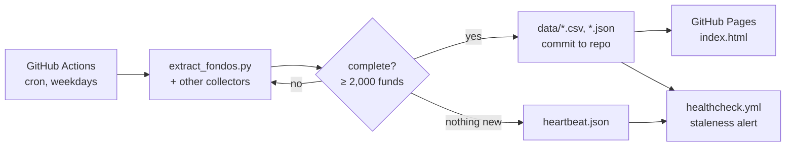

# fondos-bankinter: a daily data pipeline for 26,000+ mutual funds

A small, fully automated data product. Every weekday a GitHub Actions job takes a snapshot of the 2,000+ mutual funds sold by a Spanish bank, verifies it, commits it to this repository and publishes it as a web page on GitHub Pages. No server and no laptop needed. A second collector (`ironia_collector.py`, run locally) adds the funds of the IronIA platform, taking coverage to 26,000+ funds.

**Live page:** https://cesarrb.github.io/fondos-bankinter/ (in Spanish)

## What it does
- **Collects** fund data every weekday evening, with a morning retry if the evening run fails or comes back incomplete.
- **Checks completeness** before committing: a snapshot with fewer than 2,000 funds is retried once and flagged.
- **Keeps history**: one CSV per day (`data/history/`) plus derived series (returns, drawdowns, regimes, factor exposure, events).
- **Writes a heartbeat** on days without new prices, so silence is never confused with failure. A separate health-check workflow alerts when the data gets stale.
- **Serves a static front end** with rankings, charts, model portfolios, a portfolio builder and scenario tools. The personal "My portfolio" tab lives only in the visitor's browser (localStorage) and is never committed.

## Architecture



## Repository layout
| Path | Content |
|---|---|
| `.github/workflows/fondos.yml` | Daily snapshot with verification, retry and heartbeat |
| `.github/workflows/healthcheck.yml` | Data-freshness check |
| `extract_fondos.py`, `*_collector.py` | Collectors |
| `historia_*.py`, `mercados_*.py` | Derived history and market commentary |
| `data/` | Snapshots and derived series |
| `index.html`, `*.js` | The static front end |

## Run it locally
```bash
python -m venv .venv && source .venv/bin/activate
pip install -r requirements.txt
python extract_fondos.py
python -m http.server 8799   # then open http://localhost:8799
```

## Design choices
- **The cloud runs the schedule**, so the snapshot does not depend on a laptop being awake.
- **Measure data age, not job success**: a green job that wrote nothing new still shows up as stale.
- **Git is the database**: every snapshot is a commit, so history is diffable and reproducible.

## Disclaimer
Personal project for learning and analysis. Not investment advice. Fund data belongs to its providers.
